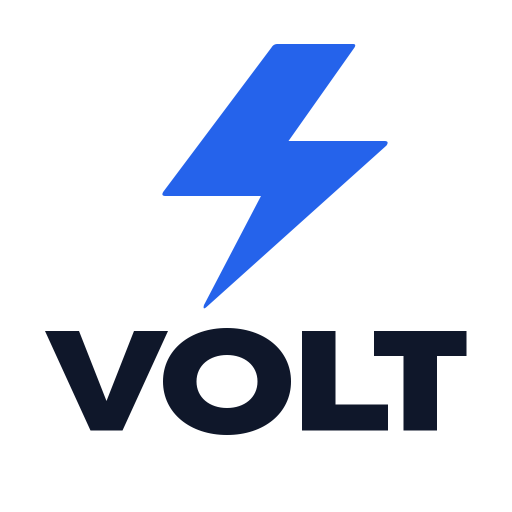

# GPT-Image-2.6 Native `<svg>` Benchmark & Zero-Dependency SVG Sanitizer

An open engineering benchmark of **native `output_format: "svg"` vector generation** (`gpt-image-2.6`) across minimal logos, wordmarks, 24×24 UI icons, badges, and die-cut stickers—plus the zero-dependency TypeScript XML AST sanitizer (`src/svg-sanitize.ts`) we run in production at **[GPTSVG Studio](https://gptsvg.com)**.

- **Live Studio**: [https://gptsvg.com](https://gptsvg.com)
- **Free Client-Side PNG/JPG → SVG Converter (No Login, Runs in Web Worker)**: [https://gptsvg.com/image-to-svg](https://gptsvg.com/image-to-svg)
- **Dedicated Vector Presets**: [AI SVG Logo Generator](https://gptsvg.com/ai-logo-svg) · [24×24 UI Icon SVG Maker](https://gptsvg.com/ui-icon-svg) · [Transparent SVG Sticker Maker](https://gptsvg.com/svg-sticker)

---

## 1. Raw Native `<svg>` Benchmark Gallery

Unlike legacy "AI vector" pipelines that generate a raster PNG and auto-trace it into 1,500+ jagged `<path>` nodes, native `output_format: "svg"` authors structured XML directly—producing semantic `<g id="...">` groups, closed Bézier geometry, and zero embedded `data:image/*` bitmaps.

| Preview | Raw `.svg` Source | Category | Quality Tier | File Size | Vector Shapes | Latency | Structural Notes |
| :---: | :--- | :--- | :---: | ---: | ---: | ---: | :--- |
|  | [`01-logo-minimal-med.svg`](./samples/01-logo-minimal-med.svg) | Minimal Brand Mark | `medium` | `1,150 B` | `9` | `56.6 s` | Semantic `<g id="fox/ears/eyes/cheeks">` layers |
|  | [`02-logo-wordmark-med.svg`](./samples/02-logo-wordmark-med.svg) | Custom Wordmark | `medium` | `951 B` | `6` | `58.0 s` | Exact spelling `VOLT`, separate `<path id="letter-*">` |
|  | [`03-icon-monoline-low.svg`](./samples/03-icon-monoline-low.svg) | 24×24 Monoline Icon | `low` | `795 B` | `5` | `55.1 s` | Native 24×24 stroke coordinate grid (`round` caps/joins) |
|  | [`04-sticker-corgi-med.svg`](./samples/04-sticker-corgi-med.svg) | Die-Cut Mascot Sticker | `medium` | `9,692 B` | `45` | `148.2 s` | White die-cut contour, transparent outside border |
|  | [`05-badge-shield-low.svg`](./samples/05-badge-shield-low.svg) | Emblem / Shield Badge | `low` | `668 B` | `4` | `39.8 s` | Clean symmetrical two-tone shield + star cutout |

---

## 2. Key Technical Takeaways from Production Testing

1. **Native `output_format: "svg"` is strictly Text-to-SVG**
   Across OpenAI and downstream inference gateways, native SVG output currently supports **text prompts only**—image-edit endpoints reject `output_format: "svg"` and require explicit `aspect_ratio` values (`1:1`, `16:9`, `9:16`, `4:3`, `3:4`) rather than `"auto"`.
   - **Workaround for Image-to-SVG**: Pair a deterministic browser-side palette quantizer + path tracer ([try it free at `/image-to-svg`](https://gptsvg.com/image-to-svg)) with an optional flat-palette AI image redraw pass before vectorization.
2. **`quality: "medium"` is the sweet spot**
   `low` works for 4–5 shape geometric emblems, but `medium` produces substantially cleaner Bézier curves and stroke alignment on monoline UI icons and character stickers while remaining under 10 KB per file.
3. **Treat LLM-authored `<svg>` as untrusted XML**
   Never mount model-generated or user-uploaded SVG markup into your app's DOM via `innerHTML` or `dangerouslySetInnerHTML`. Always reconstruct the XML AST through a strict allow-list, serve stored `.svg` files with `Content-Security-Policy: default-src 'none'; style-src 'unsafe-inline'; sandbox` + `X-Content-Type-Options: nosniff`, and render previews inside ``.

---

## 3. Zero-Dependency TypeScript SVG Sanitizer (`src/svg-sanitize.ts`)

[`src/svg-sanitize.ts`](./src/svg-sanitize.ts) implements Content Disarm & Reconstruction (CDR) in pure TypeScript with **zero npm runtime dependencies** (runs identically on Cloudflare Workers, Deno, Bun, Node.js, and modern browsers):

- **Hard-rejects XML bombs & external inclusions**: Blocks `<!DOCTYPE>`, `<!ENTITY>`, `<![CDATA[`, `<?xml-stylesheet?>`, and `xi:include` before AST construction.
- **Strict element & attribute allow-list**: Drops `<script>`, `<foreignObject>`, `<iframe>`, `<image>`, `<feImage>`, `<a>`, `<style>`, SMIL `<animate*>`/`<set>`, and all `on*` event attributes.
- **Entity-aware URI validation**: Decodes numeric/hex/named XML entities *before* checking attributes so obfuscated `javascript:`, `data:`, or remote URLs in `href` / `xlink:href` / `fill="url(...)"` cannot bypass filters (only local `#id` fragments are permitted).
- **Canonical output**: Enforces `xmlns="http://www.w3.org/2000/svg"`, validates or synthesizes a numeric `viewBox`, and verifies at least one vector geometry node exists.

```ts
import { sanitizeSvg } from './src/svg-sanitize'

const { svg, viewBox, shapeCount } = sanitizeSvg(rawModelSvg, {
  maxBytes: 512 * 1024,
})
```

---

## License

MIT © [GPTSVG Studio](https://gptsvg.com)
